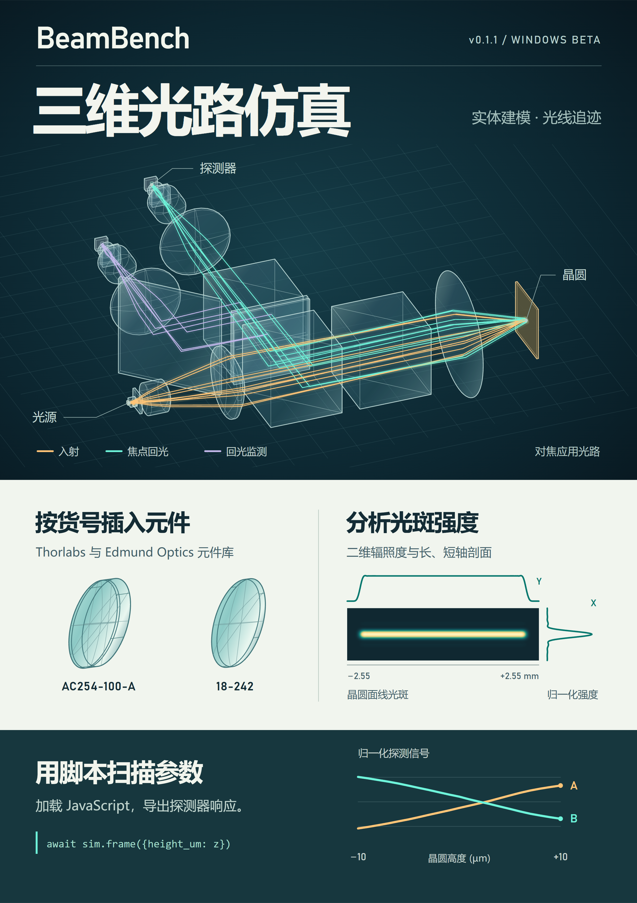

# BeamBench

BeamBench 用于搭建三维光路、分析光斑和辐照度，并用 JavaScript 运行动态扫描。

**[下载 Windows x64 测试版 v0.1.2](https://github.com/wufansaber/BeamBench-Downloads/releases/download/v0.1.2/BeamBench-v0.1.2-windows-x64.zip)** · [使用手册 PDF](https://github.com/wufansaber/BeamBench-Downloads/releases/download/v0.1.2/BeamBench-user-manual.pdf) · [元件库使用说明](component-library.md) · [SHA-256](https://github.com/wufansaber/BeamBench-Downloads/releases/download/v0.1.2/BeamBench-v0.1.2-windows-x64.zip.sha256)

解压后双击 **BeamBench.cmd**。在 **Projects → New project…** 创建光具座，或打开随附的 355 nm 线照明项目。左侧按光学功能选取元件，支持供应商货号、原始文件和自定义参数导入。

[版本说明](https://github.com/wufansaber/BeamBench-Downloads/releases/tag/v0.1.2) · [海报原图 PNG](https://github.com/wufansaber/BeamBench-Downloads/releases/download/v0.1.2/BeamBench-platform-poster.png)

